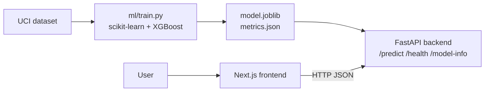

# Student Performance Predictor

A small full-stack machine learning project. You enter a student's details (study time, absences, past failures, ...) and the app predicts their **final grade (0-20)**, says whether they are on track to pass, and shows which factors pushed the prediction up or down.

> Data: the UCI [Student Performance](https://archive.ics.uci.edu/dataset/320/student+performance) dataset (maths course, 395 students).

## Screenshots

_Add your screenshots here:_

| Predict page | Model performance page |
|---|---|
| `docs/predict.png` | `docs/performance.png` |

## Architecture



## Project structure

```
ml/         training script, EDA notebook, saved model, plots
backend/    FastAPI app, tests, Dockerfile
frontend/   Next.js + Tailwind + Recharts
docker-compose.yml
```

## Machine learning

- **Target:** `G3`, the final grade.
- **Preprocessing:** one `ColumnTransformer` (one-hot for categorical columns, scaling for numeric ones) inside a single scikit-learn `Pipeline`.
- **Two experiments:** with `G1`/`G2` (earlier grades) and without them. The second one is the realistic "early prediction" case, and it is the model used by the app.
- **Models:** Linear Regression, Random Forest, XGBoost, compared with 5-fold cross-validation and a small grid search. Test set = 20% of the data.
- **Explainability:** feature importance and SHAP plots in `ml/reports/`. The API uses SHAP to return the top 5 factors for each student.

### Results

Lower RMSE/MAE is better, higher R² is better.

| Experiment | Model | CV RMSE | Test RMSE | Test MAE | Test R² |
|---|---|---|---|---|---|
| With G1/G2 | Linear Regression | 1.89 | 2.34 | 1.58 | 0.73 |
| With G1/G2 | Random Forest | 1.40 | 1.92 | 1.17 | 0.82 |
| With G1/G2 | XGBoost | 1.44 | 2.01 | 1.15 | 0.80 |
| Without G1/G2 | Linear Regression | 4.67 | 4.20 | 3.40 | 0.14 |
| Without G1/G2 | **Random Forest** (deployed) | 3.84 | 3.72 | 2.98 | 0.32 |
| Without G1/G2 | XGBoost | 3.92 | 3.99 | 3.27 | 0.22 |

Without the earlier grades the model is only moderately accurate (about 3 grade points off on average), so treat predictions as a rough guide.

## How to run

### Option 1: Docker

```bash
docker compose up --build
```

Open http://localhost:3000 (API docs at http://localhost:8000/docs).

### Option 2: Run each part yourself

**ML (optional, a trained model is already included)**

```bash
cd ml
pip install -r requirements.txt
python train.py
# then copy ml/models/model.joblib and metrics.json into backend/model/
```

**Backend**

```bash
cd backend
pip install -r requirements.txt
uvicorn main:app --reload
pytest            # run the tests
```

**Frontend**

```bash
cd frontend
cp .env.example .env.local     # API address
npm install
npm run dev
```

## API

| Method | Path | Description |
|---|---|---|
| GET | `/health` | Simple health check |
| GET | `/model-info` | Metrics and feature list |
| POST | `/predict` | Student data in, predicted grade + top 5 factors out |

## Deployment

**Backend on Render** (Railway is similar)
1. Push this repo to GitHub.
2. Render: New > Web Service, pick the repo, set **Root Directory** to `backend`, **Runtime** to Docker.
3. Deploy and copy the URL, e.g. `https://my-api.onrender.com`.

**Frontend on Vercel**
1. Vercel: New Project, pick the repo, set **Root Directory** to `frontend`.
2. Add the environment variable `NEXT_PUBLIC_API_URL` = your Render URL.
3. Deploy.

Note: CORS currently allows all origins (`*`) to keep things simple. For production, restrict `allow_origins` in `backend/main.py` to your Vercel URL. Free Render services sleep when idle, so the first request can be slow.

## Tech stack

Python, pandas, scikit-learn, XGBoost, SHAP, FastAPI, Pydantic, pytest, Next.js, React, Tailwind CSS, Recharts, Docker.

## What I learned

- Building a full ML pipeline with `ColumnTransformer` + `Pipeline` so preprocessing is never forgotten at prediction time.
- Including previous grades makes the model look great, but it is not useful for early prediction. Comparing both experiments showed this clearly.
- A small dataset means noisy results, so cross-validation matters.
- How to serve a model with FastAPI and validate input with Pydantic.
- How to explain a single prediction with SHAP and show it in a chart.
- Connecting a React frontend to an API with environment variables, and deploying the parts separately.

## Limitations

- Only 395 students from two Portuguese schools, so it may not generalise.
- Sensitive attributes (sex, relationship status) are in the data. This is a learning project and should not be used to make real decisions about students.
- The Docker setup was written but not run on the author's machine (Docker was not installed there).
